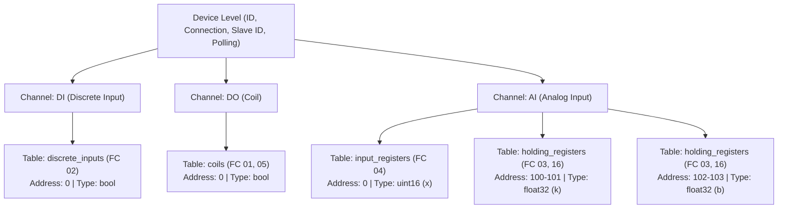
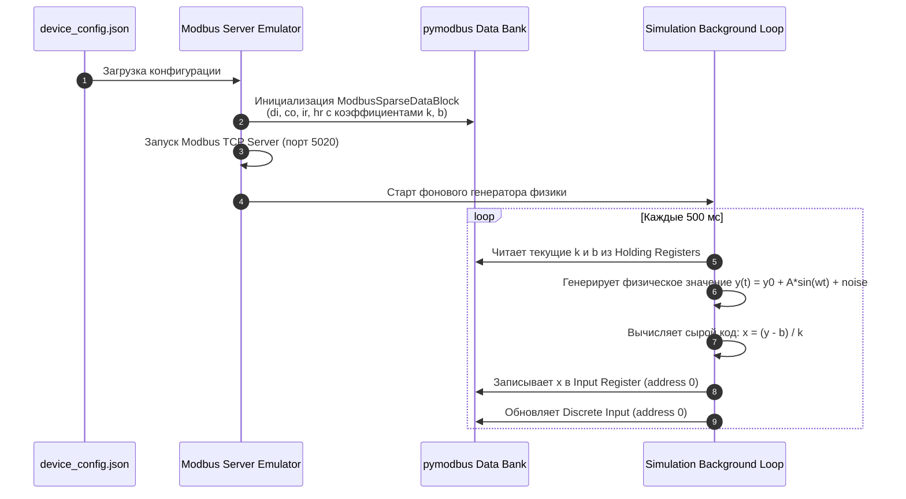
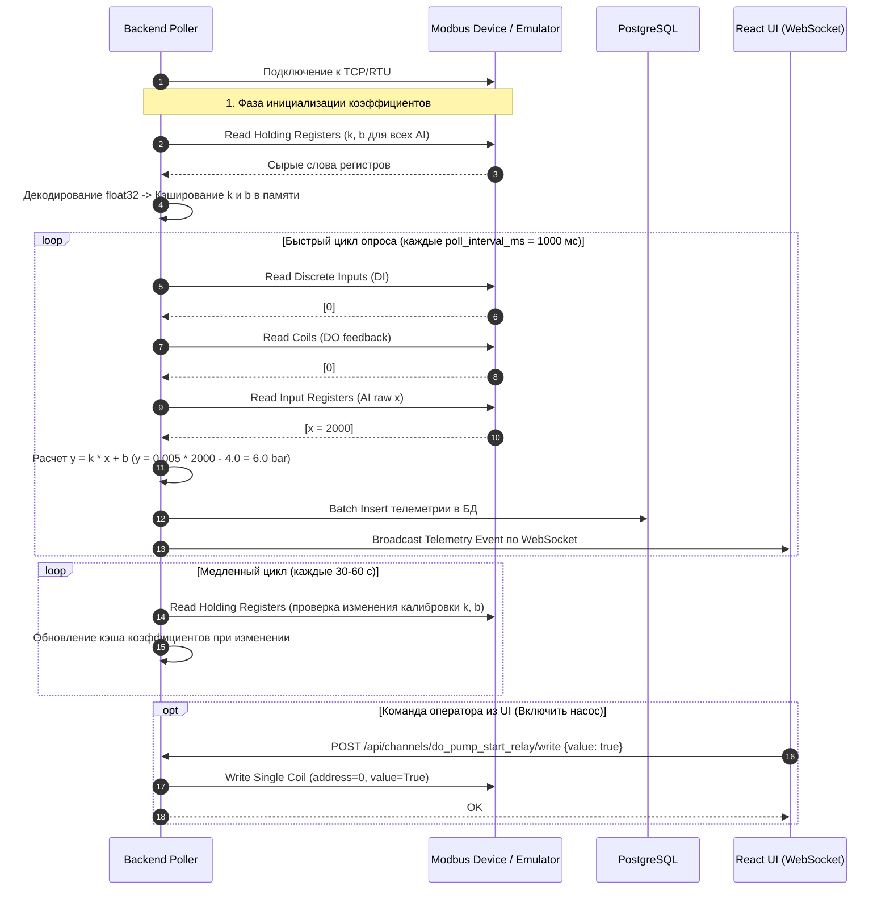

# Единая спецификация конфигурации Modbus для MiniScada

Данный модуль содержит унифицированную схему и формат конфигурации устройств Modbus (Single Source of Truth), предназначенный для совместного использования:
1. **Эмулятором Modbus-сервера** (создание регистров, имитация физических сигналов и процессов).
2. **Backend-утилитой опроса** (подключение, циклический сбор данных, пересчет в физические величины, запись в PostgreSQL и отправка в UI).
3. **Frontend (React UI)** (отображение мнемосхем, единиц измерения, диапазонов и управление DO).

---

## 📁 Содержимое каталога

* **[`config.schema.json`](file:///Users/numnov/Programming/ssau/MiniScada/Common/config.schema.json)** — Строгая JSON Schema (Draft 2020-12 / Draft-07) для валидации конфигурационных файлов.
* **[`device_config.example.json`](file:///Users/numnov/Programming/ssau/MiniScada/Common/device_config.example.json)** — Эталонный пример конфигурации комбинированного модуля (1 DI, 1 DO, 1 AI с коэффициентами $k$ и $b$ в Holding Registers).
* **[`config_models.py`](file:///Users/numnov/Programming/ssau/MiniScada/Common/config_models.py)** — Pydantic-модели (Python), функции кодирования/декодирования IEEE 754 float32, расчет линейной калибровки $y = kx + b$ и генератор карт памяти для `pymodbus`.
* **[`config_types.ts`](file:///Users/numnov/Programming/ssau/MiniScada/Common/config_types.ts)** — Строгие TypeScript интерфейсы и вспомогательные функции для React UI.

---

## 🏗️ 1. Архитектура конфигурации

Конфигурационный файл описывает физический или виртуальный модуль ввода-вывода на трех уровнях:



### 1.1. Уровень устройства (Device)
* **`device_id`**: Уникальный строковый идентификатор устройства (slug, например `"io_module_combo_01"`).
* **`slave_id`**: Modbus Unit ID / Slave ID (1..247).
* **`connection`**:
  * **Modbus TCP**: `host` (IP или hostname), `port` (обычно 502 или 5020 для тестов), `timeout_ms`.
  * **Modbus RTU**: `port` (`/dev/ttyUSB0`, `COM3`), `baudrate` (9600, 19200, 115200...), `data_bits` (8), `parity` (`N`, `E`, `O`), `stop_bits` (1, 2), `timeout_ms`.
* **`polling`**:
  * `poll_interval_ms`: Периодичность опроса рабочих регистров (DI, DO, AI raw) — например, 1000 мс.
  * `coefficients_poll_interval_ms`: Периодичность перечитывания настроечных Holding Registers ($k$ и $b$) — например, 30000..60000 мс.

### 1.2. Уровень каналов ввода-вывода (IO Channels)
* **`channel_id`**: Уникальный идентификатор (например, `"di_pump_run_status"`, `"do_pump_start_relay"`, `"ai_pipe_pressure"`).
* **`type`**:
  * **`DI`** (Digital Input) — сухой контакт / дискретный вход (0 или 1).
  * **`DO`** (Digital Output) — реле / дискретный выход (0 или 1).
  * **`AI`** (Analog Input) — физический датчик (давление, температура, уровень, ток 4..20 мА, напряжение 0..10 В).

---

## 📐 2. Маппинг Modbus и калибровка AI ($y = k \cdot x + b$)

### 2.1. Таблицы Modbus по умолчанию
В соответствии со стандартом Modbus и библиотекой `pymodbus` приняты следующие привязки по умолчанию:
* **DI** $\rightarrow$ `discrete_inputs` (1x, чтение Function Code 02).
* **DO** $\rightarrow$ `coils` (0x, чтение FC 01, запись FC 05 / FC 15).
* **AI (сырое значение $x$)** $\rightarrow$ `input_registers` (3x, чтение FC 04).

> **Важно:** Все адреса в конфигурации являются **0-based смещениями (offsets)**, что полностью соответствует соглашениям `pymodbus` (адрес `0` соответствует первому регистру таблицы).

### 2.2. Размещение коэффициентов $k$ и $b$ в Holding Registers
Согласно требованиям ТЗ, настроечные параметры $k$ и $b$ для аналоговых датчиков размещаются в **Holding Registers** (4x, чтение FC 03, запись FC 06 / FC 16). Это позволяет:
1. Хранить параметры калибровки непосредственно в энергонезависимой памяти контроллера/модуля.
2. Менять калибровку с верхнего уровня (SCADA / UI) стандартными Modbus-командами записи без перезапуска контроллера.

Коэффициенты хранятся в формате **32-битного числа с плавающей точкой IEEE 754 (float32)**, занимая **два последовательных 16-битных регистра**:
* **$k$** (Slope / Gain): адрес `100` (старшее слово) и `101` (младшее слово).
* **$b$** (Zero Offset / Bias): адрес `102` (старшее слово) и `103` (младшее слово).

### 2.3. Пример расчета для эталонного файла
Датчик давления в магистрали:
* Физический диапазон: $0.0 \dots 16.0$ бар.
* Выход датчика: $4 \dots 20$ мА.
* АЦП контроллера: 12-бит со смещением, сырые отсчеты $x \in [800, 4000]$ (где 800 соответствует 4 мА, 4000 соответствует 20 мА).

$$k = \frac{y_{\max} - y_{\min}}{x_{\max} - x_{\min}} = \frac{16.0 - 0.0}{4000 - 800} = \frac{16.0}{3200} = 0.005\text{ бар/отсчет}$$

$$b = y_{\min} - k \cdot x_{\min} = 0.0 - (0.005 \cdot 800) = -4.0\text{ бар}$$

При считывании сырого значения $x = 2000$:
$$y = 0.005 \cdot 2000 + (-4.0) = 10.0 - 4.0 = 6.0\text{ бар}$$

---

## ⚙️ 3. Логика работы Эмулятора Modbus-сервера (`pymodbus`)

Эмулятор использует конфигурационный файл для автоматической инициализации своего пространства регистров (`Data Bank`) и запуска потока симуляции:



### Пример инициализации хранилища в `pymodbus` 3.x:
```python
import asyncio
from pymodbus.server import StartAsyncTcpServer
from pymodbus.datastore import ModbusSparseDataBlock, ModbusSlaveContext, ModbusServerContext
from Common.config_models import ModbusDeviceConfig, build_initial_memory_maps, decode_float32

# 1. Загрузка конфигурации
config = ModbusDeviceConfig.model_validate(json_data)

# 2. Построение разреженных карт памяти для pymodbus
memory = build_initial_memory_maps(config)

slave_context = ModbusSlaveContext(
    di=ModbusSparseDataBlock(memory["di"]),
    co=ModbusSparseDataBlock(memory["co"]),
    ir=ModbusSparseDataBlock(memory["ir"]),
    hr=ModbusSparseDataBlock(memory["hr"]),
    zero_mode=True
)
server_context = ModbusServerContext(slaves={config.slave_id: slave_context}, single=False)

# 3. В цикле симуляции:
async def simulation_loop(slave_ctx, config):
    while True:
        # Считываем актуальные k и b (на случай если оператор изменил их по Modbus)
        hr_k = slave_ctx.getValues(4, 100, count=2)
        hr_b = slave_ctx.getValues(4, 102, count=2)
        k = decode_float32(hr_k)
        b = decode_float32(hr_b)

        # Моделируем физический сигнал давления
        y_simulated = 6.0 + 2.0 * math.sin(time.time() * 0.2)
        # Обратное преобразование в сырой код регистра
        raw_x = int(round((y_simulated - b) / k))
        raw_x = max(0, min(65535, raw_x))

        # Записываем сырое значение в Input Register
        slave_ctx.setValues(3, 0, [raw_x])
        await asyncio.sleep(0.5)
```

---

## 🔄 4. Логика работы Backend-опросника (Client Poller)

Backend-клиент использует конфигурацию для формирования двух циклов: **медленного цикла чтения коэффициентов** и **быстрого цикла опроса телеметрии**:



### Пример реализации опроса на Python:
```python
from pymodbus.client import AsyncModbusTcpClient
from Common.config_models import ModbusDeviceConfig, decode_float32

async def poll_device(config: ModbusDeviceConfig):
    client = AsyncModbusTcpClient(
        host=config.connection.tcp.host,
        port=config.connection.tcp.port,
        timeout=config.connection.tcp.timeout_ms / 1000.0
    )
    await client.connect()

    # 1. Считываем коэффициенты k и b из Holding Registers
    coefficients_cache = {}
    for ch in config.channels:
        if ch.type == "AI" and ch.coefficients:
            k_resp = await client.read_holding_registers(ch.coefficients.k.address, 2, slave=config.slave_id)
            b_resp = await client.read_holding_registers(ch.coefficients.b.address, 2, slave=config.slave_id)
            k = decode_float32(k_resp.registers)
            b = decode_float32(b_resp.registers)
            coefficients_cache[ch.channel_id] = {"k": k, "b": b}

    # 2. Основной цикл сбора данных
    while True:
        telemetry_batch = []
        for ch in config.channels:
            if ch.type == "DI":
                rr = await client.read_discrete_inputs(ch.modbus.address, 1, slave=config.slave_id)
                val = rr.bits[0]
                telemetry_batch.append({"channel_id": ch.channel_id, "raw": val, "eng": val})

            elif ch.type == "DO":
                rr = await client.read_coils(ch.modbus.address, 1, slave=config.slave_id)
                val = rr.bits[0]
                telemetry_batch.append({"channel_id": ch.channel_id, "raw": val, "eng": val})

            elif ch.type == "AI":
                rr = await client.read_input_registers(ch.modbus.address, 1, slave=config.slave_id)
                raw_x = rr.registers[0]
                k = coefficients_cache[ch.channel_id]["k"]
                b = coefficients_cache[ch.channel_id]["b"]
                eng_y = round(k * raw_x + b, 3)
                telemetry_batch.append({"channel_id": ch.channel_id, "raw": raw_x, "eng": eng_y, "unit": ch.physical_range.unit})

        # Сохранение в PostgreSQL и отправка в React UI по WebSocket
        await save_to_postgres(telemetry_batch)
        await broadcast_to_ui(telemetry_batch)
        await asyncio.sleep(config.polling.poll_interval_ms / 1000.0)
```

---

## 🗄️ 5. Рекомендуемая схема таблиц PostgreSQL

Для хранения истории показаний в PostgreSQL рекомендуется использовать следующую структуру:

```sql
-- Таблица конфигурации устройств
CREATE TABLE IF NOT EXISTS devices (
    device_id VARCHAR(64) PRIMARY KEY,
    name VARCHAR(255) NOT NULL,
    slave_id INT NOT NULL,
    config_json JSONB NOT NULL,
    created_at TIMESTAMP WITH TIME ZONE DEFAULT NOW()
);

-- Таблица каналов
CREATE TABLE IF NOT EXISTS channels (
    channel_id VARCHAR(64) PRIMARY KEY,
    device_id VARCHAR(64) REFERENCES devices(device_id) ON DELETE CASCADE,
    name VARCHAR(255) NOT NULL,
    type VARCHAR(8) NOT NULL, -- 'DI', 'DO', 'AI'
    unit VARCHAR(32),
    min_val NUMERIC,
    max_val NUMERIC
);

-- Временные ряды телеметрии (для TimescaleDB или стандартной партиционированной таблицы)
CREATE TABLE IF NOT EXISTS telemetry (
    time TIMESTAMP WITH TIME ZONE NOT NULL DEFAULT NOW(),
    channel_id VARCHAR(64) REFERENCES channels(channel_id) ON DELETE CASCADE,
    raw_value DOUBLE PRECISION NOT NULL,
    engineering_value DOUBLE PRECISION NOT NULL,
    quality VARCHAR(16) NOT NULL DEFAULT 'GOOD',
    PRIMARY KEY (time, channel_id)
);

CREATE INDEX IF NOT EXISTS idx_telemetry_channel_time ON telemetry (channel_id, time DESC);
```
